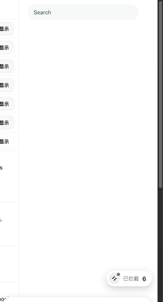
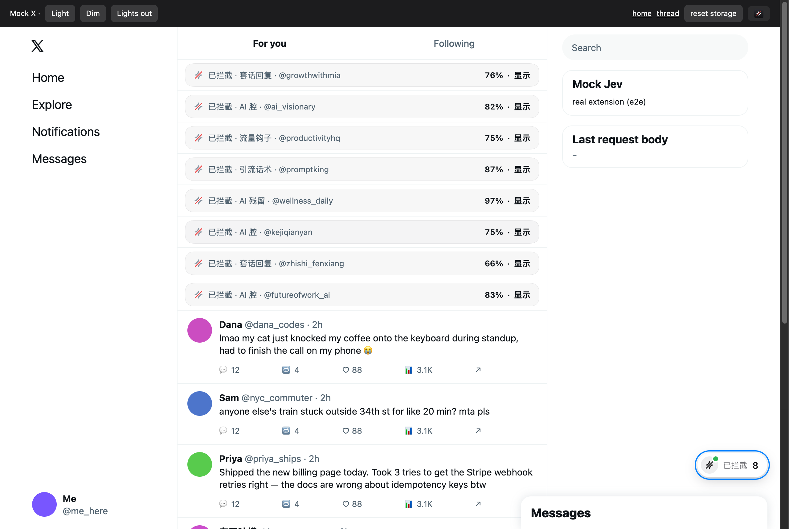
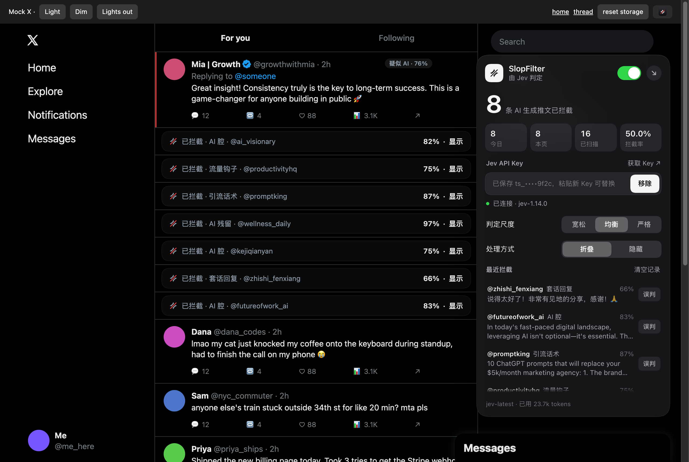

# SlopFilter · AI 水文过滤

一个 Chrome 扩展：在 X（Twitter）上用 [Jev](https://docs.typesafe.ai/api)（TypeSafe AI 的 System One 判定模型）识别 AI 生成的水文推文，把它们折叠或隐藏，并实时显示拦截了多少条。



| 时间线上被折叠的推文 | 深色模式面板 |
| --- | --- |
|  |  |

## 安装

1. 获取项目文件（二选一）：
   - 前往 [GitHub 仓库](https://github.com/HerrysYu/SlopFilter)，点击「Code」→「Download ZIP」并解压。
   - 或运行 `git clone https://github.com/HerrysYu/SlopFilter.git`。
2. 打开 `chrome://extensions`，打开右上角「开发者模式」。
3. 点「加载已解压的扩展程序」，选择解压或克隆得到的项目目录（即 `manifest.json` 所在目录）。
4. 打开 x.com，右下角会出现一个胶囊按钮「已拦截 N」。

## 填写 Jev API Key

1. 在 [console.typesafe.ai](https://console.typesafe.ai) 登录，进入 API Keys 页面创建一个 Key。
2. 点 x.com 页面上的胶囊，它会展开成面板，Key 输入框自动获得焦点。
3. 粘贴 Key，回车或点「保存」。扩展会先调用 `GET /v1/models` 验证（这一步不发送任何推文），状态点变绿即表示已连接。

没填 Key 时扩展仍能工作，但只用本地规则，只拦截特征特别明显的推文（比如直接粘贴的 ChatGPT 回复）。

## 使用

- **胶囊**：显示累计拦截数，状态点表示当前模式（绿 = Jev 判定，橙 = 仅本地规则，红 = Key 无效或出错，灰 = 已暂停）。可以拖到屏幕四个角，松手时按甩动方向吸附。
- **面板**：今日 / 本页 / 已扫描 / 拦截率；Key 设置；判定尺度（宽松 0.74、均衡 0.62、严格 0.50）；处理方式（折叠成一行，或完全隐藏）；蓝勾从严（默认开，付费蓝勾作者的拦截线再低 0.08）；最近拦截列表。
- **折叠的推文**：点一下即可展开，展开后左侧保留一条红线和「疑似 AI · xx%」标签。
- **误判**：在最近拦截里点「误判」，这条推文恢复显示，该作者以后不再拦截，计数也会扣回。
- 点浏览器工具栏上的扩展图标也能开关面板，图标角标显示本页拦截数。
- 按 `Esc`、点面板外部或右上角箭头收起面板。

## 判定流程

```
推文 DOM ──► 本地规则扫描（heuristics.js）
               │  命中的特征 → 作为提示写进 state
               ▼
           Jev /v1/systemone（prompt.js），一次问三个问题
               • is_ai_slop     noul：是不是 AI 水文
               • slop_kind      choice：哪一类（套话回复 / 流量钩子 / 引流话术 / AI 腔 / AI 残留 / 人写的）
               • human_texture  noul：有没有真人痕迹（反向信号）
               │
               ▼
   jev   = 0.5·is_ai_slop + 0.3·(1 − P(human)) + 0.2·(1 − human_texture)
   final = 0.7·jev + 0.3·本地分        （命中「AI 助手残留」这类硬特征时直接按高分处理）
               │
               ▼
   final ≥ 阈值 → 折叠 / 隐藏，并计数
```

Jev 是一个小的判定模型，自己的判断力有限，所以：

- 提示词把 AI 水文的特征逐条写进 `criteria`，不指望模型自己知道；
- 本地规则先扫一遍，把命中的特征当作提示一起发过去；
- 同一个判断用三种问法问，再加权平均，比单个答案稳定；
- 回复会附上被回复的原帖（在 `/status/` 页面），方便判断「放在哪条帖子下都成立」的套话。

## 收集到的 AI 水文特征

完整内容在 [`src/prompt.js`](src/prompt.js)（发给 Jev 的提示词）和 [`src/heuristics.js`](src/heuristics.js)（本地规则）里，分为几类：

1. **硬特征**：残留的助手腔（"Certainly!"、"As an AI"、"Here's a tweet about…"、「以下是…」「希望对你有帮助」），没替换的占位符 `[Your Name]`，整段被引号包住。
2. **套话回复（reply farming）**：先复述原帖再夸一句（"Great insight! … is a game-changer 🚀"、「说得太好了，非常有见地的分享！」），放在任何帖子下面都成立，不带任何新信息。
3. **模板句式**：「不是 X，而是 Y」/"It's not X, it's Y"，英文里的破折号，三连短句（"Faster. Smarter. Cheaper."），自问自答（"The result? …"），一句一行，结尾总结一句道理。
4. **流量钩子**："Here's the thing"、"Let that sink in"、"Most people don't know…"、🧵👇、「N 个 AI 工具」清单、结尾「你怎么看？」「建议收藏」。
5. **引流话术**：提示词合集、被动收入、无人直播、「评论 PROMPT 我私信你」、编出来的「我表哥」式案例。
6. **高频词扎堆**：delve、tapestry、testament、landscape、leverage、seamless、game-changer、"quietly reshaping"；「值得注意的是」「赋能」「底层逻辑」「在当今…时代」「引发广泛关注」。
7. **格式**：emoji 当项目符号、Unicode 花体粗体、一堆泛泛的话题标签。
8. **中文蓝勾营销号**：震惊体标题（【突发】、万万没想到、细思极恐、网友炸锅了），搬运微博/小红书的二手故事（据…报道、网传、网友爆料），互关涨粉（互关、回关、有关必回、蓝V互关），引流（进群、私信、看置顶、评论区扣1、加V），撸毛带单（空投、白名单、土狗、百倍、上车），小红书营销腔（家人们、绝绝子、闭眼入），干货标题党（一文读懂、保姆级、建议收藏），营销号式昵称（…观察、…日报、…快讯、互关…），以及在热门帖下面刷「确实如此，很有深度，值得深思」这类套话、同一句话贴在多条帖子下面。发给 Jev 的信息里会带上作者是蓝勾、金勾还是灰勾，并告诉它付费蓝勾 + 套话/模板/引流 是强信号，单有蓝勾不算。

9. **中文 AI 腔**：
   - 翻译腔句式：不是…而是…、真正的 X 从来不是 Y、与其说…不如说…、每一个…都藏着…、在…的浪潮中
   - 开头结尾套话：不得不说、有一说一、很多人不知道的是、说白了、本质上、综上所述、愿你…、与君共勉
   - 公告腔：赋能、闭环、价值沉淀、全新升级
   - 装饰性名词：底色、注脚、褶皱、年轮、锚点、温度
   - DeepSeek 式科幻比喻：分手写成「无法避免的熵增」、爱情写成「量子纠缠的玫瑰」、加班写成「屏幕蓝光在视网膜投射出谵妄的嬗变」
   - 精确到可疑的数字：第七根睫毛、凌晨 4:27
   - 疗愈腔：被看见、温柔地接住、允许一切发生
   - 一条短帖里堆好几个「——」
   - 「专家笔记」式的新 AI 腔：用「」引出规则名再接「这条」，「被普遍忽略」开头，「——」后面接解释，「是要维护的资产不是一次性提示词」这种没有「而是」的压缩反转，「配套一条：」，「都该…」，中英文之间整齐加空格，口语词贴在严密的论证上

   例子参考了 [虎嗅：DeepSeek 的文风](https://m.huxiu.com/article/4135031.html) 和 [人人都是产品经理上关于 AI 味的文章](https://www.woshipm.com/ai/6316640.html)。

同时列出了**真人信号**作为反向证据：具体的个人细节、有立场的观点、玩笑和反讽、lol / ngl / 笑死 / 绷不住 之类的口语、错别字、全小写、粗口、针对原帖细节的回复。任何单一特征都不算证据，要几个叠在一起才算；拿不准时偏向判为人写的。

参考资料：[Wikipedia: Signs of AI writing](https://en.wikipedia.org/wiki/Wikipedia:Signs_of_AI_writing)、[Slop factories: a taxonomy of slop on Twitter/X](https://www.producthunt.com/p/zeroslop/slop-factories-a-taxonomy-of-slop-on-twitter-x)、[Signs an X article was written by AI](https://xdigestly.pages.dev/blog/signs-x-article-written-by-ai)。Jev 接口格式参考 [TypeSafe API reference](https://docs.typesafe.ai/api)、[flaviocopes 的 Jev 指南](https://flaviocopes.com/jev-api-key/) 和 [Apidog 的 Jev 指南](https://apidog.com/blog/jev-api-key/)。

## 隐私

- 发给 `api.typesafe.ai` 的内容：推文正文、语言、作者显示名和 @handle、是否认证、回复的原帖或引用的推文（截断）、本地规则命中的特征。
- API Key 只存在本机的 `chrome.storage.local`，只发给 `api.typesafe.ai`；面板里只显示首尾几位。
- 统计和最近拦截列表（推文前 140 字）只存在本机。扩展没有其他网络请求。

## 测试

```bash
node test/heuristics.test.mjs
```

```bash
node test/e2e.mjs
```

`e2e.mjs` 会启动无头 Chrome，把 `x.com` 和 `api.typesafe.ai` 映射到本地的 HTTPS 模拟服务器，加载这个扩展本身，再跑一遍：本地模式、填 Key、Jev 判定、键盘操作、隐藏模式、点击展开、深色主题、形变动画的过冲和打断。需要本机装有 Google Chrome 和 openssl；加 `E2E_FRAMES=1` 会额外录下慢放的形变帧。

Chrome 不在默认路径时，可用 `CHROME=/path/to/chrome node test/e2e.mjs` 指定 Chrome 可执行文件。

也可以直接在普通网页里看界面（用 `chrome.*` 的模拟层跑同一套脚本）：

```bash
python3 -m http.server 8765
```

然后打开 <http://localhost:8765/test/mock-x.html>。任何以 `ts_` 开头的 Key 都能通过模拟验证；`?view=thread` 是会话页，`?slowmo=6` 把动画放慢 6 倍。

## 已知限制

- 请求格式按 TypeSafe 的公开文档实现，并用模拟服务器测过，但还没对真实接口跑过。如果接口返回 422，面板的状态行会显示具体是哪个字段不对。
- X 改版时 `data-testid` 选择器可能失效，需要更新 `src/content.js` 顶部的 `SEL`。
- 据上面的 Jev 指南，Jev 对英文的准确度最好；中文推文主要靠提示词里的中文特征和本地规则补足。
- 连续曲率圆角用的是 CSS `corner-shape: superellipse()`（Chrome 139+），旧版 Chrome 会退回普通圆角。

## 许可证

本项目采用 [MIT 许可证](LICENSE)。

## 文件

```
manifest.json
src/background.js   service worker：调 Jev、缓存判定、统计、角标
src/prompt.js       发给 Jev 的三个问题（提示词）和结果解析
src/heuristics.js   本地规则（中英文 AI 水文特征）
src/content.js      读取 X 的推文、请求判定、折叠/隐藏
src/ui.js           胶囊 ↔ 面板的流体形变界面（Shadow DOM）
src/spring.js       阻尼弹簧（response / damping 参数）
src/page.css        被拦截推文在 X 页面上的样式
src/shared.js       默认设置、阈值、混合公式
scripts/make_icons.py  生成图标
test/               规则测试、端到端测试、模拟时间线
```
